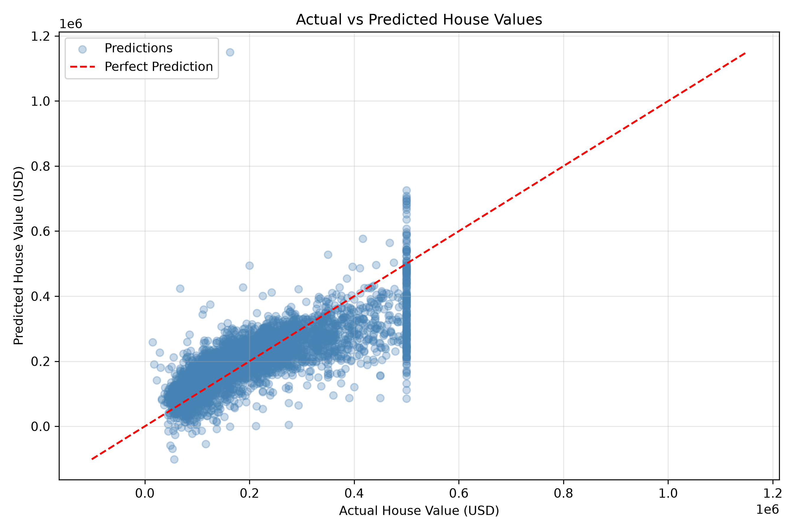

# House Price Prediction Using Machine Learning

A Python machine learning project that predicts median house values using the California Housing dataset and Linear Regression.

## Project Overview

This project demonstrates a complete machine learning workflow, including data loading, data preparation, model training, evaluation, and visualization.

The dataset contains 20,640 records with housing-related features from California.

## Technologies Used

- Python
- Pandas
- NumPy
- Scikit-learn
- Matplotlib

## Dataset

The project uses the California Housing dataset provided by Scikit-learn.

The dataset includes:
- Median income
- Median house age
- Average number of rooms
- Average number of bedrooms
- Population
- Average household occupancy
- Latitude and longitude

The target variable is the median house value, expressed in units of $100,000.

Note: The dataset contains historical, area-level housing data rather than current individual property prices.

## Machine Learning Model

- Algorithm: Linear Regression
- Training data: 80%
- Testing data: 20%
- Random state: 42

## Model Performance

| Metric | Result |
|---|---|
| MAE | $53,320.01 |
| RMSE | $74,558.14 |
| R² Score | 0.5758 |

The model explains approximately 57.6% of the variance in the test dataset.

## Visualization

The project includes a scatter plot comparing actual and predicted house values.



## How to Run

1. Clone the repository.
2. Install the required libraries:

```bash
pip install pandas numpy scikit-learn matplotlib
```

3. Run the project:

```bash
python main.py
```

## Author

Esma Koc

Computer Science Student | Python & Machine Learning
